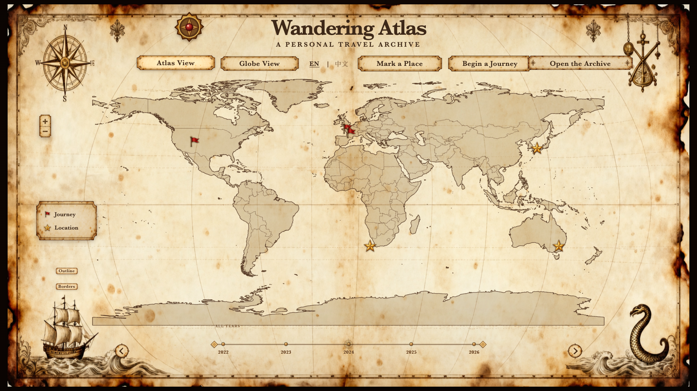
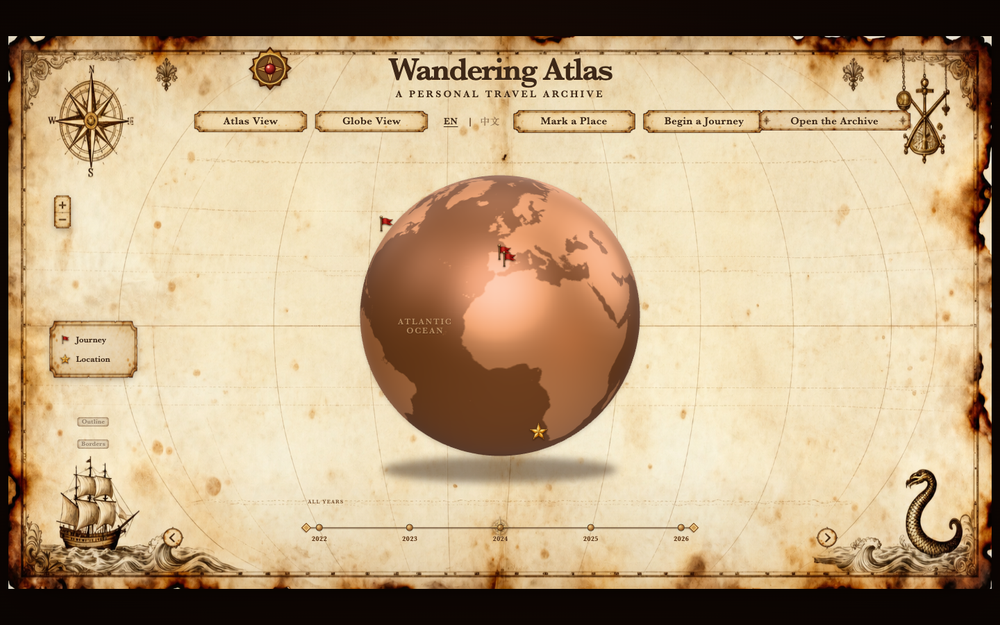
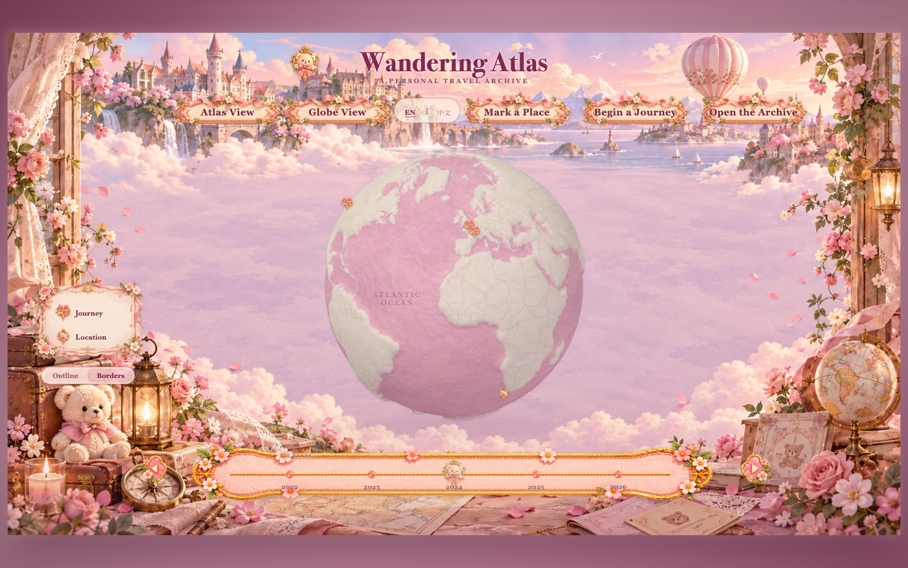
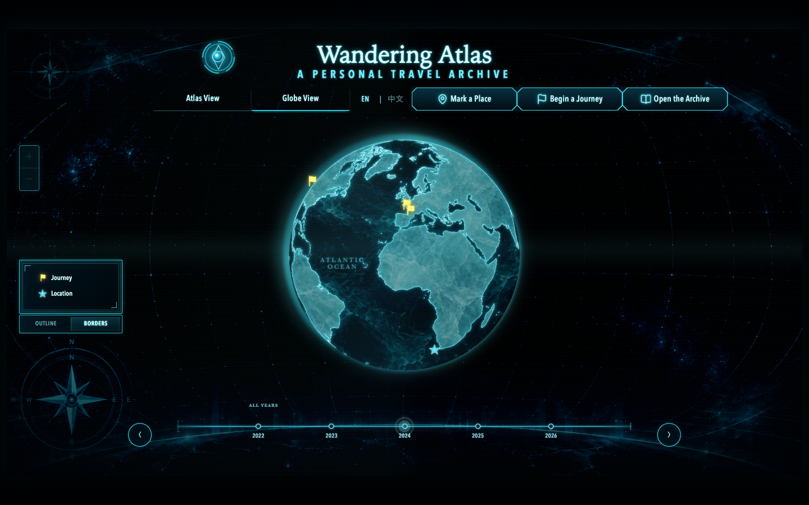
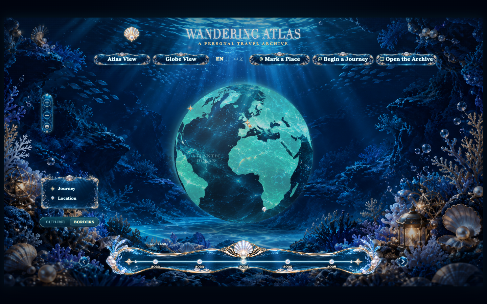
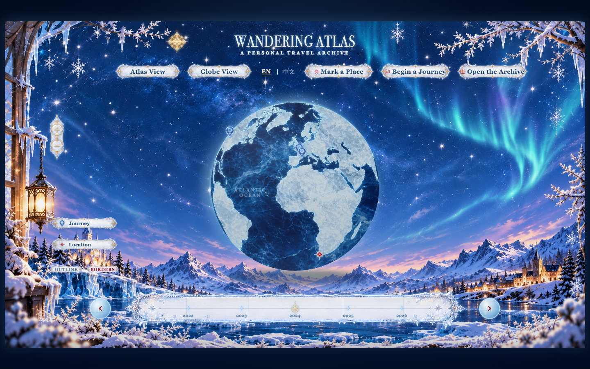
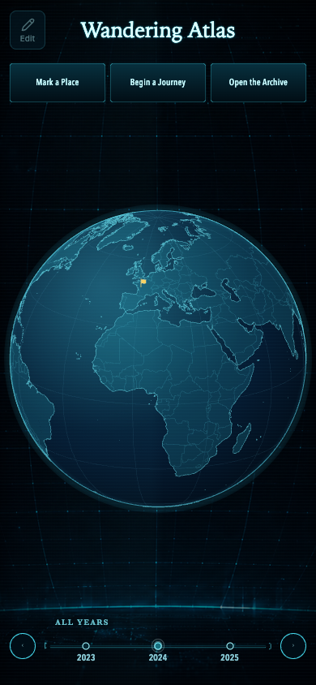
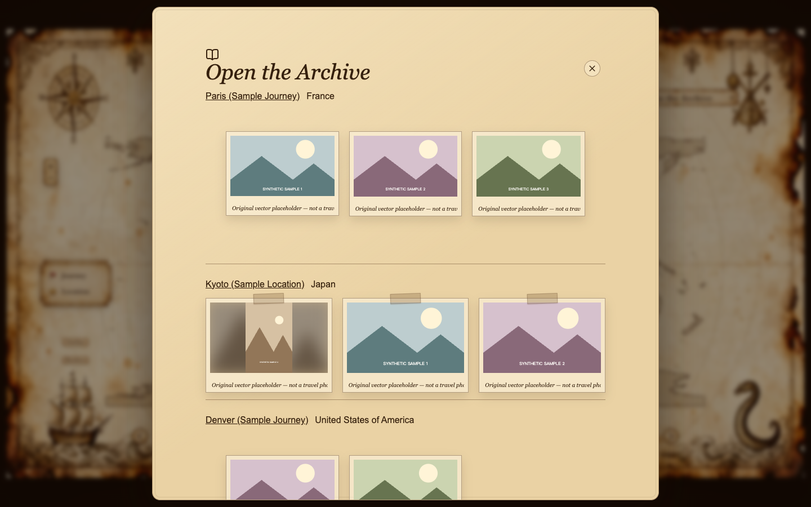
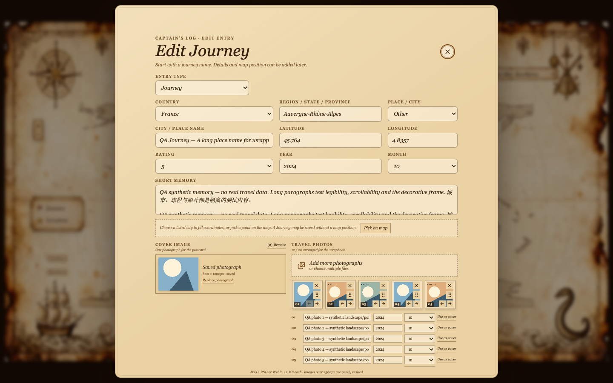

<h1 align="center">Wandering Atlas</h1>

<p align="center"><strong>A personal travel archive, with a world to wander.</strong></p>
<p align="center">Interactive maps, memorable places, and five visual worlds for your journeys.</p>
<p align="center"><a href="#five-visual-themes">Themes</a> · <a href="#quick-start">Quick Start</a> · <a href="#local-editing">Local Editing</a> · <a href="#license--credits">License &amp; Credits</a></p>



Wandering Atlas turns journeys and places into an interactive travel archive. Explore a rotating Globe or a world map, follow your timeline, and open postcards and photo collections in a theme that feels like your own.

The included demo is fictional. Your local records and uploaded photos stay in a separate, ignored directory; no Cloudflare account, D1, R2, or owner login is required.

## Features

- **Interactive Globe / World Map** — rotate the Globe or explore countries on the desktop Atlas, with map zoom, Outline and Borders controls.
- **Journey & Location** — record countries, cities, dates, memories, ratings and photographs with distinct markers.
- **Timeline / Postcard / Archive** — browse all years or focus on one, open a place's postcard, and explore its photo gallery.
- **Five Desktop Themes** — Parchment, Fairy Tale, Cyber, Deep Sea and Ice World, each with its own materials and decorative language.
- **Local Editing** — create, edit and delete entries; upload photos, arrange their order and choose a cover.
- **Customizable Travel Archive** — edit the sample JSON, use local images, or extend the existing theme configuration.
- **Cyber Mobile Lite** — a lightweight, texture-free Globe with touch rotation and pinch zoom, three primary actions, an explicit Edit / Done switch and a three-year timeline. Mobile has no automatic rotation or theme switching.

## Five Visual Themes

On desktop, choose **Change Atlas** to switch themes. Mobile uses **Cyber Mobile Lite**. Theme IDs are shown below for customization.

| Parchment · `parchment` | Fairy Tale · `fairy-tale` |
| --- | --- |
|  |  |
| **Cyber · `cyber`** | **Deep Sea · `deep-sea`** |
|  |  |
| **Ice World · `ice-world`** | **Cyber Mobile Lite** |
|  |  |

## Screenshots

<details>
<summary><strong>Open the Archive</strong> — browse places and their photographs</summary>



</details>

<details>
<summary><strong>Local Editing</strong> — dates, memories, coordinates and photos</summary>



</details>

These are actual browser captures, not mockups. Desktop screenshots use fictional demo entries or synthetic QA fixtures; photographs shown in them are original geometric placeholders. The mobile capture shows the current Cyber Mobile Lite demo; Edit is disabled in the read-only demo and available in the local editor. [Capture provenance](docs/screenshots/README.md).

## Quick Start

Requires **Node.js 22.13+** and npm.

```sh
git clone https://github.com/Katherine965/wandering-atlas.git
cd wandering-atlas
npm ci
npm run dev:local
```

Open **http://127.0.0.1:5175** to use the local editor. The command prints its address if you choose a different port.

To browse the fictional, read-only demo instead:

```sh
npm run dev
```

The demo runs at **http://127.0.0.1:5174**. Its editing actions are unavailable; start `dev:local` to add your own entries.

For a production build of the read-only demo:

```sh
npm run build
npm start
```

The built server runs at **http://127.0.0.1:4174**. This build uses the public sample dataset; it does not automatically publish your private local archive. No environment file or cloud credentials are needed.

## Local Editing

On desktop:

1. Select **Begin a Journey** to enable editing.
2. Select **Mark a Place** to create a Journey or Location. Choose a city to fill coordinates, or enter them manually; desktop Atlas also supports picking a map point.
3. Add dates, a memory, a rating and photographs. Arrange photos and set a cover before saving.
4. Use **Open the Archive** to browse your collection and edit existing records.

On mobile, select **Edit** first. **Begin a Journey** then creates a Journey, and **Mark a Place** creates a Location. Select **Done** to return to browsing; creation and record editing stay disabled until you enable editing again. The archive remains available for browsing in the local editor. A fresh page starts with editing off.

Records, uploaded images and local backups are saved under **`.local/archive/`**, outside the public demo and excluded by `.gitignore`. They survive refreshing the page and restarting the local server. Preserve that complete directory, including its images, to keep your archive. Automated import/restore is not implemented in v1.0.

The local editor runs on the local server; a statically hosted copy remains a read-only viewer. Share only data and photographs you intend to publish and have rights to redistribute.

## Themes / Customization

- **Your content:** edit [data/sample-travel.json](data/sample-travel.json) and rebuild a public demo; [Customization](docs/CUSTOMIZATION.md) describes the schema and image paths.
- **Your theme:** start with the five configurations under [app/travel/themes](app/travel/themes) and the [theme guide](docs/THEMES.md).
- **Reusable guidance:** the [theme-builder Skill](docs/skills/travel-theme-builder/SKILL.md) includes layout, materials, postcard and validation references.
- **Project internals:** see [Architecture](docs/ARCHITECTURE.md) and [Security](docs/SECURITY.md).

Use images you have permission to share. Personal archives and uploaded photographs are not automatically covered by the project's license.

## Development

```sh
npm run typecheck
npm run lint
npm test
npm run build
```

Optional browser regression checks use installed Google Chrome through Playwright: `npm run test:browser`. Mobile browser simulation does not certify real-device iPhone Safari or GPU performance.

Before distributing a compiled package, run `npm run check:release`. Build output includes license texts, attribution and provenance documents; retain them with the package.

## License & Credits

Original project code is licensed under the **[MIT License](LICENSE)**, copyright **2026 Katherine965**. Third-party materials keep their own licenses.

- **Theme imagery:** AI-assisted / user-directed artwork with qualified, nonexclusive permissions and provenance in [ASSETS.md](ASSETS.md). No exclusive copyright or blanket clearance of third-party reference inputs is claimed.
- **Geographic data:** made with **Natural Earth**. City suggestions use Natural Earth and **GeoNames**, with GeoNames-derived data under **CC BY 4.0**. [Sources and attribution](THIRD_PARTY_NOTICES.md#verified-geographic-data).
- **Libraries & fonts:** React, Three.js, d3, Lucide, fflate, sharp and Instrument Serif, among others. Full terms and credits are retained in [THIRD_PARTY_NOTICES.md](THIRD_PARTY_NOTICES.md) and [licenses/](licenses).

The demo and README screenshots contain no personal travel photographs. Non-owned film/game themes are outside the release scope.
